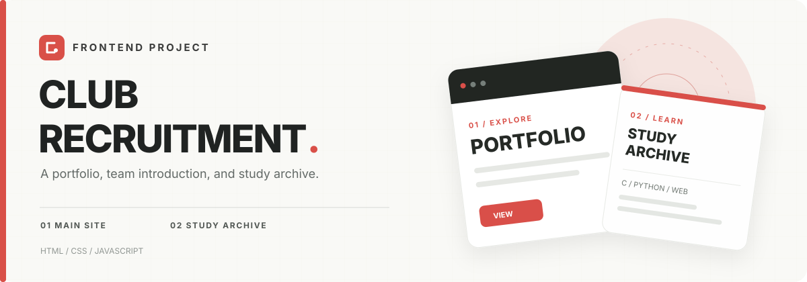

<div align="center">
  

  <br />

  <strong>팀 소개와 모집 화면, 그리고 개발 학습 기록을 하나의 정적 웹사이트로.</strong>

  <p>
    <a href="./index.html"></a>
    <a href="./club/index.html"></a>
    <a href="./study/index.html"></a>
  </p>

  <p>
    
    
    
    
  </p>
</div>

---

## Overview

**Club Recruitment**는 팀/동아리 소개 및 채용 UI를 실험한 웹 페이지와, 별도로 제작한 **Study Archive**를 하나의 저장소로 정리한 프런트엔드 프로젝트입니다.

| 01 · Portfolio & Recruitment | 02 · Study Archive |
| :--- | :--- |
| 팀 소개, 멤버, 프로젝트, 활동, 지원 폼을 담은 단일 페이지 사이트 | C 언어·Python·개발 영어·기초 수학 학습 자료를 정리한 문서형 사이트 |
| 다크/라이트 테마, 화면 전환, 스크롤 애니메이션 | 주제별 필터, 글 카드, 개별 학습 문서 8개 |
| [메인 페이지 소스](./index.html) · [클럽 페이지 소스](./club/index.html) | [아카이브 소스](./study/index.html) · [글 목록](./study/posts/) |

메인 페이지에서 **Study Archive — 학습 노트 보기** 링크를 누르면 학습 아카이브로 이동합니다.

## Features

- **Single-page navigation** — HOME, 멤버, 프로젝트, 활동, 채용 영역을 JavaScript로 전환합니다.
- **Theme switcher** — 다크/라이트 테마 전환 및 브라우저 내 테마 설정 저장 기능이 있습니다.
- **Recruitment UI demo** — 지원 분야 선택과 입력 폼을 체험할 수 있습니다.
- **Study Archive** — 4개 주제의 글 8개를 카테고리별로 탐색할 수 있습니다.
- **No build step** — HTML/CSS/JavaScript만 사용하여 별도 프레임워크나 빌드 과정이 필요하지 않습니다.

<details>
<summary><strong>프로젝트 구조 펼쳐보기</strong></summary>

```text
club_recruitment/
├── index.html               # 메인 포트폴리오·모집 데모
├── club/
│   └── index.html           # 별도 클럽 경로
├── study/
│   ├── index.html           # 학습 자료 목록
│   ├── css/style.css
│   ├── js/app.js
│   └── posts/               # 학습 글 8개
│       ├── basic-math/
│       ├── c-language/
│       ├── python/
│       └── software-english/
├── docs/
│   └── readme-cover.svg
└── README.md
```

</details>

## Getting Started

```bash
git clone https://github.com/homesweetlove/club_recruitment.git
cd club_recruitment
python -m http.server 8000
```

| 페이지 | 로컬 주소 |
| :--- | :--- |
| Main | <http://localhost:8000/> |
| Club | <http://localhost:8000/club/> |
| Study Archive | <http://localhost:8000/study/> |

Python이 없다면 VS Code Live Server 등 정적 파일 서버로도 실행할 수 있습니다.

## Important Notes

> [!IMPORTANT]
> **지원 폼은 시연용입니다.** 제출 버튼을 눌러도 브라우저에서 확인 알림만 보여주며, 서버 전송·DB 저장·이메일 발송은 이루어지지 않습니다.

멤버 소개, 프로젝트 링크 및 모집 일정 등 일부 화면 콘텐츠는 예시 데이터입니다. 실제 모집·운영 정보로 사용하기 전에 별도 검증이 필요합니다.

## Deployment

GitHub Pages를 사용하려면 저장소의 **Settings → Pages**에서 `Deploy from a branch`, `main / (root)`를 선택하세요. 활성화 후 일반적인 프로젝트 페이지 주소는 아래와 같습니다.

- Main: `https://homesweetlove.github.io/club_recruitment/`
- Study: `https://homesweetlove.github.io/club_recruitment/study/`

> GitHub Pages가 활성화되어 있다는 의미는 아닙니다. 위 주소는 배포 설정 후 사용할 수 있는 경로 안내입니다.

---

<div align="center">
  <sub>Originally created in <a href="https://github.com/zlem8952/remind.github.io">zlem8952/remind.github.io</a> · Maintained by <a href="https://github.com/homesweetlove">homesweetlove</a></sub>
</div>
